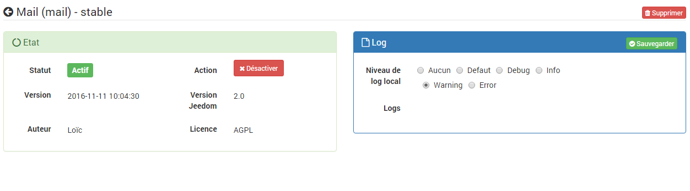
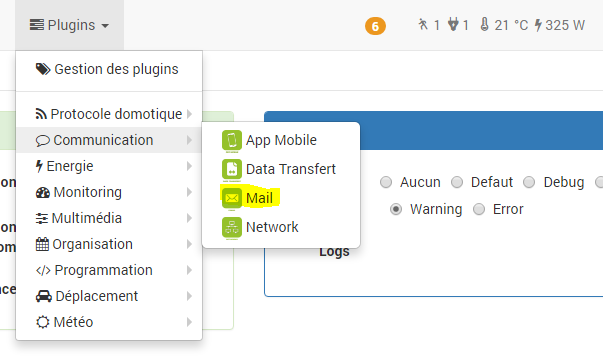
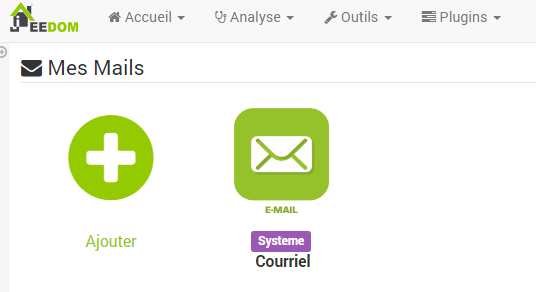
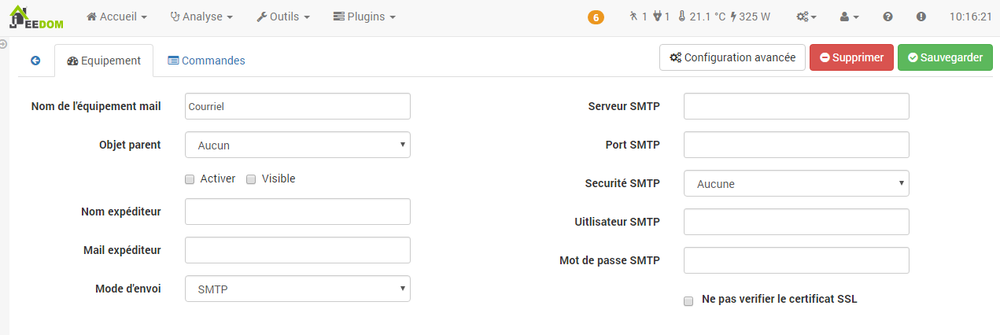
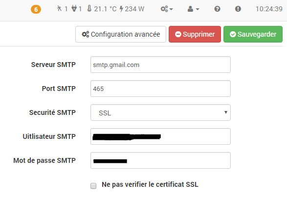
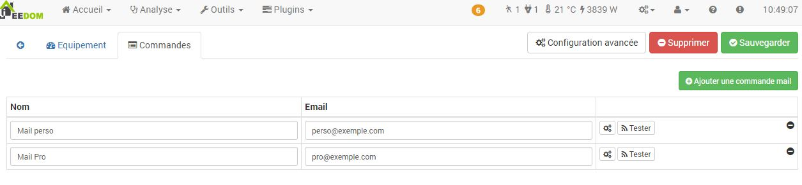
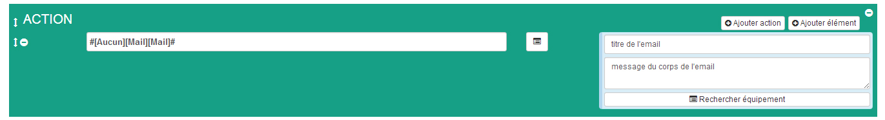

# Plugin Mail

Plugin permettant d’envoyer et de recevoir des mails :

-   **Envoi** : depuis un scénario, une interaction ou tout autre élément de Jeedom, par SMTP, Sendmail, Qmail, la fonction mail() de PHP ou le service Jeedom Cloud
-   **Réception** : surveillance d’une boîte mail en IMAP, chaque nouveau mail met à jour des commandes info qui peuvent déclencher des scénarios
-   **Authentification OAuth2** pour Google (Gmail, Google Workspace) et Microsoft (Microsoft 365, Outlook.com, Hotmail), en envoi comme en réception

# Configuration du plugin 

Après avoir installé le plugin, activez-le puis lancez l’installation des dépendances si Jeedom le demande.

La page de configuration est accessible depuis **Plugins → Gestion des plugins → Mail**, ou avec le bouton **Configuration** de la page du plugin. Pour un simple envoi par mot de passe, aucun réglage n’est nécessaire. Elle contient :

-   **Démon** : état du démon de réception des mails. Il n’est lancé que si au moins un équipement a la réception activée ; sinon il apparaît comme OK avec le message « Aucun équipement en réception »
-   **Port socket interne** : port local utilisé par Jeedom pour communiquer avec le démon (55072 par défaut). À ne modifier qu’en cas de conflit avec un autre plugin
-   **Application OAuth2 Google** : ID client et code secret de l’application Google, nécessaires uniquement pour l’authentification Google OAuth2
-   **Application OAuth2 Microsoft** : ID d’application et locataire de l’application Microsoft, nécessaires uniquement pour l’authentification Microsoft OAuth2

La création de ces applications est détaillée dans le chapitre « Authentification OAuth2 » ci-dessous.

Le démon a son propre log, `mail_daemon`, en plus du log `mail` du plugin.

# Configuration des équipements 

La configuration des équipements Mail est accessible à partir du menu plugin :

Voilà à quoi ressemble la page du plugin Mail (ici avec déjà 1 mail, vous pouvez en mettre autant que vous voulez avec le bouton "Ajouter"). Le bouton "Configuration" ouvre la page de configuration du plugin :

Une fois que vous cliquez sur l’un d’eux, vous obtenez :

Vous retrouvez ici toute la configuration de votre équipement :

-   **Nom de l’équipement mail** : nom de votre équipement mail
-   **Objet parent** : indique l’objet parent auquel appartient l’équipement
-   **Activer** : permet de rendre votre équipement actif
-   **Visible** : rend votre équipement visible sur le dashboard
-   **Nom expéditeur** : nom de l’expéditeur du mail (ex : Jeedom)
-   **Mail expéditeur** : mail de l’expéditeur (ex : <jeedom@moi.fr>)
-   **Authentification** : mot de passe, Google (OAuth2) ou Microsoft 365 / Outlook (OAuth2). Elle sert à l’envoi SMTP comme à la réception IMAP, voir le chapitre « Authentification OAuth2 » ci-dessous
-   **Mode d’envoi** : mode d’envoi du mail :
    -   Jeedom cloud : aucune configuration à faire, envoi des mails par le service Cloud Jeedom, en phase beta pour le moment, limité à 5 mails par jour
    -   SMTP : mode le plus courant pour l’envoi de mails
    -   Sendmail
    -   Qmail
    -   Mail()\[PHP Function\] : utilise la [fonction d’envoi standard de PHP,window="\_blank"](http://fr.php.net/manual/fr/function.mail.php), nécessite de configurer le système d’exploitation

Hormis l’option SMTP, les autres options nécessitent la configuration de l’OS (Linux) pour pouvoir fonctionner. Autrement dit, de base seule la fonction SMTP fonctionne, les autres sont réservées aux experts qui pourront, s’ils le souhaitent, paramétrer eux-mêmes ces options.

L’onglet configuration SMTP permet de renseigner les informations du serveur d’email que vous voulez utiliser.

Voici quelques exemples pour les principaux fournisseurs de services email :

-   **Gmail**
    -   Serveur SMTP : smtp.gmail.com
    -   Port SMTP : 587
    -   Sécurité SMTP : TLS
-   **Hotmail**
    -   Serveur SMTP : smtp.live.com
    -   Port SMTP : 587
    -   Sécurité SMTP : TLS
-   **iCloud**
    -   Serveur SMTP : smtp.me.com
    -   Port SMTP : 25
-   **Yahoo.com**
    -   Serveur SMTP : smtp.mail.yahoo.com
    -   Port SMTP : 465
    -   Sécurité SMTP : SSL

> **Important**
>
> Google et Microsoft restreignent de plus en plus l’accès par mot de passe. Pour Gmail, Google Workspace, Microsoft 365, Outlook.com et Hotmail, utilisez l’authentification OAuth2.

Les champs « Utilisateur SMTP » et « Mot de passe SMTP » correspondent aux identifiants de votre compte email. Ils sont masqués en authentification OAuth2 : l’identité du compte connecté est alors utilisée.

A partir de l’onglet "Commandes", vous pouvez ajouter des commandes qui correspondent aux adresses email auxquelles vous souhaitez pouvoir envoyer des emails avec Jeedom :

-   **nom** : nom de la commande
-   **email** : l’adresse email à laquelle envoyer le message. Vous pouvez en mettre plusieurs en les séparants par des ,
-   **configuration avancée** (petites roues crantées) : permet     d’afficher la configuration avancée de la commande (méthode     d’historisation, widget, etc.)
-   **tester** : permet de tester la commande,
-   **supprimer** (signe -) : permet de supprimer la commande.

# Réception des mails

Chaque équipement peut aussi surveiller une boîte mail en IMAP. Dès qu’un nouveau mail arrive, les commandes info de l’équipement sont mises à jour et peuvent déclencher un scénario.

La configuration se fait dans l’onglet **Réception** de l’équipement :

-   **Activer la réception** : active la surveillance de la boîte mail
-   **Serveur IMAP**, **Sécurité IMAP** et **Port IMAP** : paramètres de connexion au serveur (993 en SSL/TLS, 143 en STARTTLS ou sans sécurité)
-   **Utilisateur IMAP** et **Mot de passe IMAP** : identifiants du compte (le mot de passe est chiffré en base). Ils sont masqués en authentification OAuth2
-   **Ne pas vérifier le certificat SSL** : à n’utiliser que pour un serveur local avec un certificat auto-signé
-   **Dossier surveillé** : dossier IMAP à surveiller, `INBOX` par défaut
-   **Marquer comme lu** : marque les mails traités comme lus sur le serveur. Sans cette option la boîte mail n’est pas modifiée
-   **Expéditeurs** : ne traite que les mails dont l’adresse de l’expéditeur contient l’une des valeurs indiquées (séparées par des virgules), par exemple `alarme@exemple.com, @mondomaine.fr`
-   **Sujet contient** : ne traite que les mails dont le sujet contient ce texte
-   **Enregistrer les pièces jointes** : enregistre les pièces jointes sur Jeedom. Elles sont supprimées automatiquement après le nombre de jours indiqué dans **Conservation** (7 par défaut)

La réception utilise un démon, visible sur la page de configuration du plugin. Il n’est lancé que si au moins un équipement a la réception activée. Il est prévenu instantanément par le serveur (IMAP IDLE) ; si le serveur ne le permet pas, la boîte est vérifiée toutes les minutes.

Au premier lancement, seuls les mails arrivés après l’activation sont traités. Si le démon est arrêté puis relancé, les mails reçus entre-temps sont traités à son redémarrage.

Une fois la réception activée et l’équipement sauvegardé, les commandes info suivantes sont créées :

-   **Date de réception**
-   **Expéditeur** : adresse mail de l’expéditeur
-   **Nom expéditeur**
-   **Destinataire**
-   **HTML** : contenu HTML du mail
-   **Texte** : contenu texte du mail (calculé à partir du HTML si le mail n’a pas de version texte)
-   **Pièces jointes** : chemins des pièces jointes enregistrées, séparés par des virgules. Ils peuvent être réutilisés tels quels dans l’option « fichiers » d’une commande d’envoi de mail
-   **Sujet**

Les commandes sont mises à jour dans cet ordre, la commande **Sujet** en dernier. Pour déclencher un scénario à la réception d’un mail, utilisez donc la commande **Sujet** comme déclencheur : toutes les autres informations du mail sont déjà à jour. Le scénario est déclenché même si deux mails consécutifs ont le même sujet.

> **Important**
>
> Microsoft (Outlook, Hotmail, Microsoft 365) n’autorise plus la connexion IMAP ni SMTP par mot de passe : utilisez l’authentification OAuth2 décrite ci-dessous. Pour Gmail, vous pouvez utiliser OAuth2 ou un mot de passe d’application.

Quelques exemples de serveurs IMAP :

-   **Gmail** : imap.gmail.com, port 993, SSL/TLS
-   **iCloud** : imap.mail.me.com, port 993, SSL/TLS
-   **Yahoo.com** : imap.mail.yahoo.com, port 993, SSL/TLS
-   **Orange** : imap.orange.fr, port 993, SSL/TLS
-   **Free** : imap.free.fr, port 993, SSL/TLS

# Authentification OAuth2 (Google et Microsoft 365)

Le champ **Authentification** de l’équipement permet de choisir entre un mot de passe et une connexion OAuth2 à un compte Google ou Microsoft (Microsoft 365, Outlook.com, Hotmail). L’authentification choisie sert à la fois à l’envoi (SMTP) et à la réception (IMAP). En OAuth2, aucun mot de passe n’est enregistré dans Jeedom.

En choisissant Google ou Microsoft, les serveurs et ports SMTP et IMAP sont pré-remplis s’ils sont vides.

## Prérequis : déclarer une application OAuth2

Google et Microsoft n’autorisent l’accès aux mails qu’à une application déclarée chez eux. Ses identifiants se renseignent une seule fois, dans la page de configuration du plugin (bouton **Configuration** de la page du plugin) ; une même application sert pour tous les équipements.

### Google

1.  Dans la [console Google Cloud](https://console.cloud.google.com/), créez un projet
2.  Dans **API et services → Écran de consentement OAuth**, configurez l’écran de consentement (type « Externe » pour un compte Gmail, « Interne » pour Google Workspace), puis ajoutez votre adresse comme utilisateur test
3.  Dans **API et services → Identifiants**, créez un **ID client OAuth** de type **Application de bureau**
4.  Recopiez l’**ID client** et le **Code secret du client** dans la configuration du plugin

> **Important**
>
> Avec Google Workspace, choisissez le type « Interne » : aucune validation Google n’est nécessaire et la connexion n’expire pas. Si IMAP est désactivé, l’administrateur doit l’autoriser dans la console d’administration (**Applications → Google Workspace → Gmail → Accès des utilisateurs finaux**).
>
> Tant que l’application est en mode « Test » chez Google, la connexion expire au bout de 7 jours. Pour un compte Gmail personnel, passez l’application en « Production » dans l’écran de consentement (Google affichera un avertissement « application non validée » lors de la connexion, il suffit de continuer). Ce n’est pas nécessaire pour une application « Interne » Google Workspace.

### Microsoft

1.  Dans le [portail Microsoft Entra](https://entra.microsoft.com/), ouvrez **Inscriptions d’applications → Nouvelle inscription**
2.  Choisissez « Comptes dans un annuaire d’organisation et comptes Microsoft personnels » (ou seulement votre organisation), sans URI de redirection
3.  Dans **Authentification**, activez **Autoriser les flux de clients publics**
4.  Dans **Autorisations de l’API → Ajouter une autorisation → API utilisées par mon organisation → Office 365 Exchange Online**, ajoutez les autorisations déléguées **IMAP.AccessAsUser.All** et **SMTP.Send**
5.  Recopiez l’**ID d’application (client)** dans la configuration du plugin. Si l’application n’accepte que les comptes de votre organisation, indiquez aussi l’ID du locataire (sinon laissez `common`)

Sur Microsoft 365, l’administrateur doit aussi autoriser IMAP et « SMTP authentifié » pour la boîte mail concernée.

## Connecter le compte

Sauvegardez l’équipement après avoir choisi Google ou Microsoft, puis cliquez sur **Connecter le compte** :

-   **Google** : une fenêtre Google s’ouvre pour autoriser l’accès. Google redirige ensuite vers une page qui ne s’affiche pas (adresse `http://127.0.0.1:47823/...`) : c’est normal. Copiez l’adresse complète de cette page, collez-la dans le champ affiché par Jeedom et cliquez sur **Valider**
-   **Microsoft** : Jeedom affiche un code. Saisissez-le sur la page Microsoft qui s’ouvre, puis connectez-vous ; Jeedom détecte automatiquement la fin de l’autorisation

Le compte connecté s’affiche ensuite à côté du bouton. La connexion est renouvelée automatiquement. Le bouton **Déconnecter** supprime les accès enregistrés dans Jeedom.

En cas de problème (application supprimée, accès révoqué depuis le compte Google ou Microsoft, mot de passe du compte changé…), l’erreur est indiquée dans les logs `mail` et `mail_daemon` : cliquez à nouveau sur **Connecter le compte**.

# Utilisation

Ce plugin fonctionne comme un module, c’est-à-dire qu’une fois sauvegardé, il apparaît dans la liste des actions ou commandes. Il est ainsi très simple de l’utiliser lors de la création de scénarios par exemple.

Dans un scénario, une fois sélectionné dans une action, il faudra saisir le titre et le message.

> **Important**
>
> En authentification par mot de passe avec Gmail, il faut utiliser un mot de passe d’application : Mon compte ⇒ Sécurité ⇒ Validation en deux étapes ⇒ Mots de passe des applications. L’authentification OAuth2 évite cette manipulation.

> **Tip**
>
> Le format HTML est supporté par l’éditeur de scénario pour le corps des messages.

> **Tip**
>
> Pensez à sauvegarder toutes les modifications.
